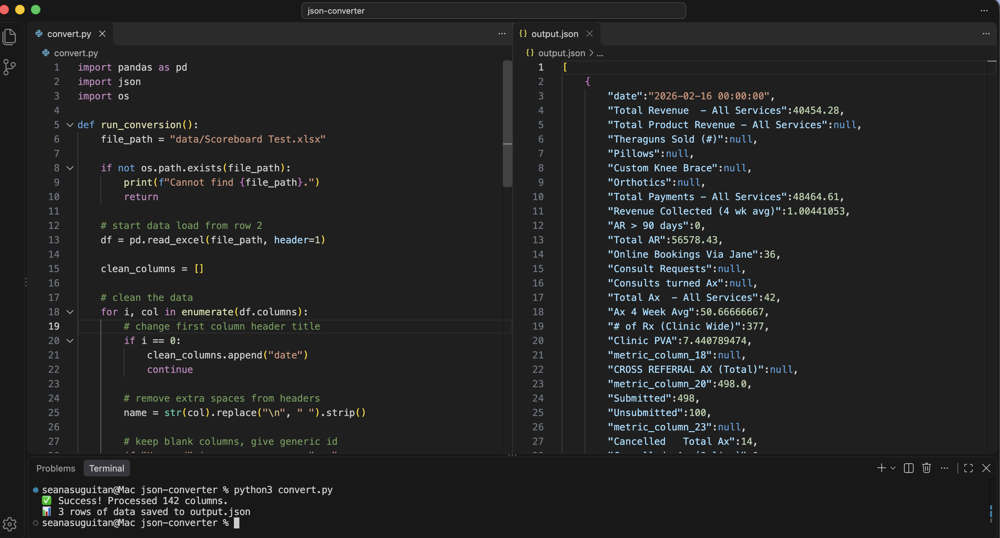

# Excel → JSON Converter 

---



---

## Table of Contents
* [How To Run](#how-to-run)
* [JSON Shape Chosen](#json-shape-chosen)
* [The Messy Bits and Trade-Offs](#the-messy-bits-and-trade-offs)

---

## How To Run
1.  **Install Dependencies:**
- macOS: 
    ```bash
    pip3 install -r requirements.txt
    ```
- Windows: 
    ```bash
    py -m pip install -r requirements.txt
    ```
2. **Run Converter Script:**
   - **macOS:**
     ```bash
     # Run with sample file
     python3 convert.py

     # Or run with a custom file path
     python3 convert.py path/to/your_file.xlsx
     ```

   - **Windows:**
     ```bash
     # Run with sample file
     py convert.py

     # Or run with a custom file path
     py convert.py path\to\your_file.xlsx
     ```
3.  **Result:**
    Check  ``output.json`` for cleaned data.

---

## JSON Shape Chosen
An Array of Objects (`orient='records'`) provides an intuitive experience for developers and LLM agents.

- **Self-Contained**: Each object contains a single timestamped record anchored by the `date` key.
- **Developer Experience**: Eliminates complex extraction logic and allows data to be fed  into a UI component or agent harness.

### Snippet Example
```json
{
    "date": "2026-02-16 00:00:00",
    "Total Revenue - All Services": 40454.28,
    "metric_column_20": 498.0,
    "Total AR": 56578.43
}
```
---

## The Messy Bits and Trade-Offs
My strategy focused on maintaining total data integrity.

### 1. Static Metadata vs. Time-Series
Intentionally stripped values in Rows 3–7 (*Focus, Source etc.*).
- **Trade-off**: Loses human readable context. Dropping them ensures JSON contains clean weekly data.

### 2. Lossless Columns 
Kept all vertical spacer columns and assigned them generic IDs (`metric_column_20`).
- **Trade-off**: Captures instances where user might accidentally type a value into wrong column (like the `498.0` before SUBMITTED). 

### 3. Values Over Formulas
Used the `openpyxl` engine to extract calculated results rather than raw Excel strings (e.g., `=SUM(...)`).
- **Trade-off**: Loses internal spreadsheet logic. Data however becomes immediately usable for math operations in a dashboard or LLM. 


### 4. Merged Cells
Normalized merged headers into distinct, queryable keys. Ensures readability for LLM.
- **Trade-off**: Trades human readable grouping for machine readability.